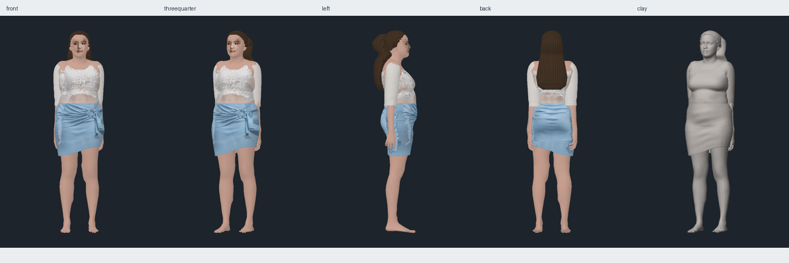

# 3d · 本地人物重建

使用 **SMPL-X + 四视图体型拟合 + 独立服装/实体头发 + 按类别过滤的贴图投影**，将参考素材转换为可编辑人物模型和打印版 STL。

本项目整理自 Windows + RTX 4060 Laptop 8 GB 的 V2 本地实验。输出为 GLB、OBJ/MTL/PNG、200 mm STL 和实际网格渲染预览。仓库包含本次原照片、参考图和 V2 预览；SMPL-X 权重、拟合检查点及大型生成模型保留本地。



这张图是此前 V2 输出。审查补丁主要修正拟合分辨率依赖、配置项和几何循环，不代表已完成更高精度的人脸或发型重建。

## 当前效果与边界

| 内容 | 已实现 | 当前限制 |
| --- | --- | --- |
| 人体 | 多视图共享体型、各视图独立姿态/正交相机；有界 SMPL-X+D | 默认身高 1.695 m 为未测量先验，可配置；合成视图不是扫描真值 |
| 衣物 | 独立上衣、袖子、袖口、斜下摆裙 | 参数化几何；多数褶皱来自贴图 |
| 头发 | 删除 V1 脸侧薄片，闭合后发实体埋入头部/上背 | 简化发块和程序纹理，未恢复真实发丝 |
| 贴图 | 同类像素过滤、边缘腐蚀、深度遮挡检查、4K 图集 | 颜色/区域规则分割；遮挡区域使用同类补色 |
| 脸部 | 模型 51 点对齐单张原照片，面颊匹配、边缘过渡 | 只补充外观，未恢复身份几何；原照片不是独立验证集 |
| 打印 | 实体化、椭圆底座、脚踝加粗、单闭合 STL | 需切片支撑和实物验证；未检查全局最小特征厚度 |
| 动画 | GLB 内嵌 55 关节和近似转移权重 | 未验证动作兼容性与变形质量 |

**没有运行 Sapiens 法线估计或法线损失。** 本地 Blender 命令行此前未成功启动；成功流程为 Python 导出，不生成 `.blend`，也不依赖 Blender MCP。

## 环境

推荐 Python **3.11** 独立环境。`pyproject.toml` 固定主要数值库版本，避免 NumPy 2 与当前 Numba/scikit-image 的 ABI 冲突。

```powershell
uv venv --python 3.11 .venv
uv pip install --python .venv\Scripts\python.exe torch==2.8.0 --index-url https://download.pytorch.org/whl/cu128
uv pip install --python .venv\Scripts\python.exe -e '.[vision]' third_party/mediapipe/wheels/mediapipe-0.10.14-cp311-cp311-win_amd64.whl
```

第一条安装命令选择 CUDA 12.8 的 PyTorch；CPU 环境应自行选择适配的 PyTorch 构建。`vision` 包含 MediaPipe 旧版 `solutions` 接口，首次从图像拟合时需要。安装需要网络；计算阶段不调用云端生成服务。

仓库另存了 [MediaPipe 0.10.14 的 Windows/Python 3.11 安装包、四个 TFLite 模型及两个计算图](third_party/mediapipe/README.md)。上面的 Windows 安装命令使用该本地 wheel；其他平台可以保留 `-e '.[vision]'`，由包管理器选择适配版本。完整离线安装还需准备其他 Python 依赖，备份文件可运行 `python scripts/vendor_mediapipe.py --verify` 校验。

上面的独立环境是整理后的安装方式，尚未在空白系统重新安装验证；本机复跑使用已有 Python 3.11、PyTorch 2.8.0+cu128、NumPy 1.26.4 环境。具体数值检查见 [验证记录](docs/validation.md)。

## 配置输入

```powershell
Copy-Item config.example.toml config.local.toml
```

修改 `config.local.toml`：

| 配置 | 说明 |
| --- | --- |
| `paths.smplx_model` | 自行取得的 `SMPLX_FEMALE.npz`，要求 10475 顶点 / 55 关节、UV 与静态脸部标志点数组 |
| `paths.original_photo` | 原始照片；默认 `data/original.jpg` |
| `paths.turnaround` | 四视图参考板；默认 `data/turnaround.png` |
| `paths.work_dir` | 可写工作目录；默认 `work` |
| `paths.baseline_delivery` | 可选 V1 输出目录，仅生成对比图时使用 |
| `runtime.device` | `auto` / `cuda` / `cpu`；CUDA 不可用时显式请求会报错 |
| `views` | 按 front、left、right、back 顺序配置裁切框与初始 yaw |
| `face` | 原照片和已裁切正视图中的脸部 ROI |
| `subject.height_m` | 拟合身高先验，默认 1.695 m；范围 1.0–2.3 m |
| `subject.height_measured` | 只有真实量测时才设为 `true`，默认 `false` |
| `fit.height_weight` | 身高先验权重，默认 0.4 |
| `fit.use_view_weights` | 是否使用 `views.json` 的 `geometry_weight`，默认 `false` 以保持原有数值行为 |

**相对路径均相对于配置文件所在目录**，与启动命令的当前目录无关。示例裁切框适配原实验的 791×614 四视图板；换图必须检查裁切、脸部 ROI、颜色分割和衣物几何先验。目前不是任意人物/任意服装的一键重建工具。

SMPL-X 权重不在仓库内。请从 [SMPL-X 项目](https://smpl-x.is.tue.mpg.de/)取得相应文件并遵守其发布条款；代码提交不改变权重或输入照片的权利归属。版本指纹见 [模型说明](models/README.md)，图片列表和校验值见 [输入说明](data/README.md)。

## 运行

### 新图像从头运行

放好输入图像、确认配置后：

```powershell
.venv\Scripts\python.exe run.py --config config.local.toml doctor
.venv\Scripts\python.exe run.py --config config.local.toml run
```

没有拟合检查点时自动执行预处理和拟合；存在 `work/fit/fit_result.npz` 时默认复用，再重建几何、贴图和导出。强制拟合用 `run --refit`。

更换人物或图像时应使用新的 `work_dir`，避免复用其他图像的拟合/脸部缓存。若 MediaPipe 缺少其本地推理文件，应在安装阶段补齐；计算阶段的 Python socket 限制会拒绝自动下载。

### 从这次 V2 本地实验继续

```powershell
python -s run.py --config config.local.toml bootstrap --source ..\multiview_v2
python -s run.py --config config.local.toml --legacy-user-site doctor
python -s run.py --config config.local.toml --legacy-user-site run
```

`bootstrap` 仅用于导入之前的本地 V2 目录：复制原照片、四视图板、预处理、拟合检查点和脸部缓存。默认拒绝覆盖已有目标；确需覆盖时显式添加 `--overwrite`。

`--legacy-user-site` 为现有 Anaconda 环境的兼容模式：先载入基础 NumPy 1.26，再载入用户目录已安装的 GPU/视觉依赖。独立虚拟环境无需此开关，也无需修改基础安装。

PowerShell 包装入口：

```powershell
./run_local.ps1 -Python .venv\Scripts\python.exe
# 现有环境：
./run_local.ps1 -LegacyUserSite
```

安装包后也可使用 `human3d` 或 `python -m human3d`，参数与 `run.py` 一致。

## 分阶段执行

```powershell
python run.py --config config.local.toml stage geometry
python run.py --config config.local.toml stage export
python run.py --config config.local.toml stage validate
```

| 阶段名 | 作用 / 前置数据 |
| --- | --- |
| `prepare` | 四视图裁切、GrabCut、规则标签、MediaPipe 姿态关键点 |
| `check-core` | Torch 与独立 NumPy LBS 数值对照、位移不改变关节检查 |
| `fit` | 共享体型 + 每视图姿态/相机 + 有界法线位移；需要 prepared |
| `canonical` | 统一站姿；需要 fit |
| `geometry` | 独立衣物、闭合后发、同类来源筛选、单图脸部对齐 |
| `export` | 4K 图集、GLB 骨架、OBJ、底座与加粗脚踝的 STL |
| `validate` | GLB 结构与加载、STL 闭合/方向/连通性/高度 |
| `validate-revision` | 发块闭合、埋入人体、指定截面厚度、脚踝截面与贴图来源 |
| `preview` | 实际网格的彩色、灰模、打印版与脸部近景 |

前置阶段不会被单阶段命令自动补跑。完整流程通过独立 Python 子进程依次执行，并在失败时停止。

## 输出

全部位于配置的 `work_dir`：

| 路径 | 内容 |
| --- | --- |
| `prepared/` | 裁切图、mask、规则标签、关键点与检查图 |
| `fit/` | `fit_result.npz` 与拟合报告 |
| `surface/` | 分层网格、源图、脸部缓存、类别筛选统计、打印体积场 |
| `delivery/character_multiview.glb` | 内嵌贴图、近似骨架权重的人物模型 |
| `delivery/character_multiview.obj` | 分组网格；搭配 `.mtl` 和 `character_albedo.png` |
| `delivery/character_print_200mm.stl` | Z 向上、毫米单位、总高 200 mm 的实体打印版 |
| `delivery/preview_board.png` | 正、侧、后、三分之四与灰模总览 |
| `delivery/detail_*.png` | 脸部与头发近景 |
| `delivery/validation.json` | 格式、闭合、连通性与高度检查 |
| `delivery/revision_validation.json` | 本次薄发/穿脸/脚踝缺陷的专项检查 |

GLB/OBJ 为交叠的可编辑分层曲面，不等同于已融合的单体 STL。STL 使用前后深度包络和体积场实体化，会填平部分前后空腔；不保留衣物内部结构。厚度报告只覆盖所列截面，不能替代全局特征、支撑或实物打印检查。

## 代码结构与测试

`src/human3d/` 中：`core.py` 为 LBS/投影/栅格器；`layered.py` 为衣物与头发；`texture_semantics.py` 为类别源图与肤色处理；`settings.py` 管理配置；`cli.py` 负责流程；`stages/` 保存各阶段。

```powershell
python run_tests.py
python run_tests.py --slow
python run.py --config config.local.toml stage check-core
```

单元测试不需要真实模型或照片，覆盖路径解析、拟合分辨率与视图权重、向量化几何与原循环的一致性、遮挡串色及 Python socket 限制。`--slow` 额外生成椭球形合成模型，在 534 px / 300 px 两种面板高度下完整拟合，检查体型参数变化；它不是人物重建精度评测。结果摘要保存在 `work/test_results.json`。

本机已有环境可用 `python -s run_tests.py --legacy-user-site --slow`；测试的拟合子进程会继承该兼容模式。标准 `python -m unittest discover -s tests -v` 仍可使用，默认跳过慢速测试；设置 `HUMAN3D_SLOW_TESTS=1` 可启用。

完整几何/打印验证需要真实本地输入及 SMPL-X 权重。

`offline.py` 在计算子进程加载依赖前拒绝 Python socket 连接、DNS、发送和绑定，并关闭常见遥测开关。**这是 Python 审计限制，不是操作系统网络沙箱，不能保证拦截原生库的所有 I/O。** GitHub 操作与安装不属于计算子进程。

关于旧实现来源、头发薄片原因和未实现功能，见 [实现说明](docs/implementation.md) 与 [第三方说明](NOTICE.md)。
